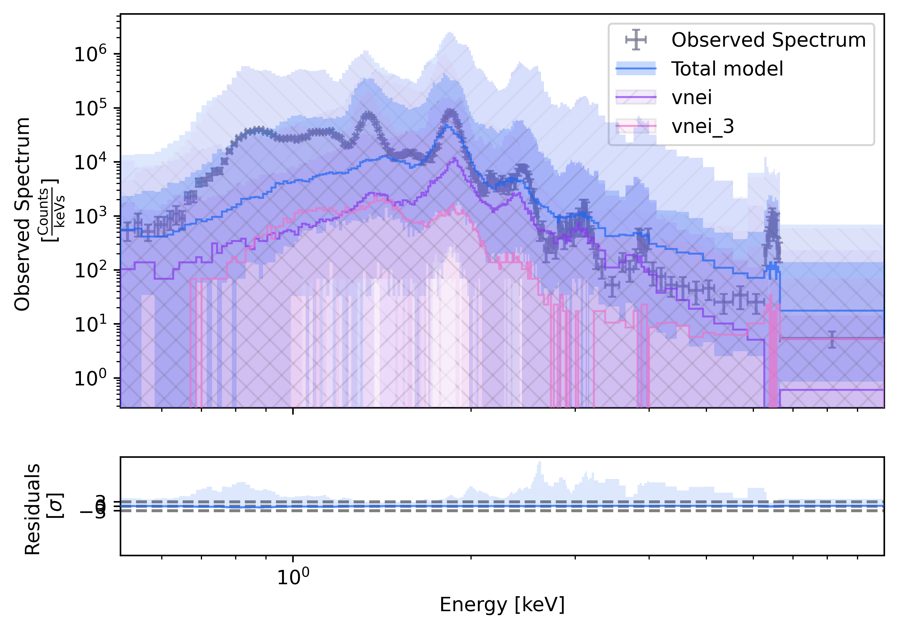
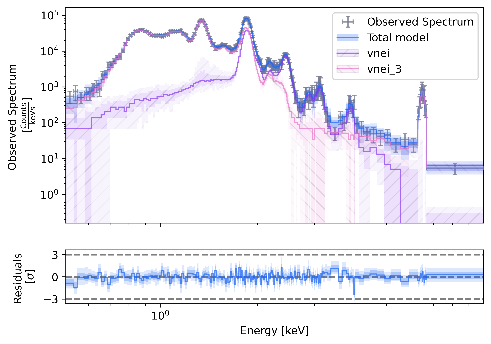

# Simple fit

This page walks through a complete fit that is representative of the Tycho SNR analysis as seen by Chandra/ACIS, from loading OGIP files with `PyXSPEC` to checking the posterior predictive coverage. The snippets are meant to be read in order: each block builds on the objects created in the previous one.

## Data loading with PyXSPEC

Start by importing `PyXSPEC`, clearing any state left from a previous interactive session, and setting the XSPEC options used for this fit.

``` python title="Mandatory imports and clearing"
import xspec

xspec.AllData.clear()
xspec.AllModels.clear()

# Some settings for XSPEC
xspec.Fit.statMethod = "cstat"  # Poisson likelihood (C-statistic)
xspec.Fit.bayes = "off"         # bsixsa applies the priors itself
xspec.Xset.xsect = "vern"
xspec.Xset.abund = "lpgs"
```

Next, let's load the source spectrum together with its response files. Once the data are loaded, we ignore the bad channels and restrict the fit to the energy band of interest.

``` python title="Load the data with OGIP files"
xspec_observation = xspec.Spectrum(
    "fakeit_tycho_raw.pha",
    respFile="reg_64_10093.rmf",
    arfFile="reg_64_10093.arf",
)

# Removing bad channels
xspec.AllData.ignore("bad")

# Set the energy band
low_energy, high_energy = 0.5, 10.
xspec_observation.ignore(f"0.0-{low_energy:.1f} {high_energy:.1f}-**")
```

With the data in place, define the spectral model that will be sampled. Here the absorption component multiplies two `vnei` plasma components, which lets the fit capture multiple thermal populations.

``` python title="Setup the XSPEC model"
xspec.Xset.addModelString("NEIAPECROOT","3.1.3") # Extra model variable
xspec_model = xspec.Model("tbabs*(vnei + vnei)")
xspec_model.show()
```

## Prior distributions

The next block freezes or links the `PyXSPEC` parameters that are not fitted, then declares the priors of the parameters that are. Every parameter must be frozen, linked, or given a prior; a prior on a frozen parameter thaws it (here several abundances and the redshift, which XSPEC freezes by default).

`PyXSPEC` and the prior entries name the components differently. `PyXSPEC` calls them `TBabs`, `vnei` and `vnei_3`: only the repeated `vnei` gets a suffix, its position in the model expression. The prior entries name both copies by position, `vnei_2` and `vnei_3`, as the result columns do (`vnei_2_kT`, ...). Both spellings are accepted (see [Writing the prior](../index.md#writing-the-prior)).

``` python title="Define prior distributions"
from bsixsa.priors import uniform, loguniform
from bsixsa.convenience import XSilence

with XSilence():
    # Both plasma components share one redshift.
    xspec_model.vnei_3.Redshift.link = xspec_model.vnei.Redshift

    # PyXSPEC's string 'value,delta,hard_low,soft_low,soft_high,hard_high':
    # a negative fit delta freezes the parameter at this value.
    xspec_model.TBabs.nH = '0.7,-1,0,0,9999,9999'

    xspec_model.vnei.H = '1,-1,0,0,9999,9999'
    xspec_model.vnei.He = '1,-1,0,0,9999,9999'
    xspec_model.vnei.C = '1,-1,0,0,9999,9999'
    xspec_model.vnei.N = '1,-1,0,0,9999,9999'
    xspec_model.vnei.O = '1,-1,0,0,9999,9999'
    xspec_model.vnei.Ne = '1,-1,0,0,9999,9999'
    xspec_model.vnei.Fe = '1,-1,0,0,9999,9999'
    xspec_model.vnei.Ni = '1,-1,0,0,9999,9999'
    xspec_model.vnei.Ca = '1750,-1,0,0,9999,9999'

    xspec_model.vnei_3.H = '1,-1,0,0,9999,9999'
    xspec_model.vnei_3.He = '1,-1,0,0,9999,9999'
    xspec_model.vnei_3.C = '1,-1,0,0,9999,9999'
    xspec_model.vnei_3.N = '1,-1,0,0,9999,9999'
    xspec_model.vnei_3.O = '1,-1,0,0,9999,9999'
    xspec_model.vnei_3.Ne = '1,-1,0,0,9999,9999'
    xspec_model.vnei_3.Mg = '1000,-1,0,0,9999,9999'
    xspec_model.vnei_3.Si = '1000,-1,0,0,9999,9999'
    xspec_model.vnei_3.S = '1,-1,0,0,9999,9999'
    xspec_model.vnei_3.Ar = '1,-1,0,0,9999,9999'
    xspec_model.vnei_3.Ca = '1,-1,0,0,9999,9999'

prior = [
    ("vnei_2", "kT", uniform(0.4, 5.)),
    ("vnei_2", "Mg", loguniform(0.1, 500.)),
    ("vnei_2", "Si", loguniform(50., 5_000.)),
    ("vnei_2", "S", loguniform(50., 5_000.)),
    ("vnei_2", "Ar", loguniform(50., 5_000.)),
    ("vnei_2", "Tau", loguniform(5e8, 5e11)),
    ("vnei_2", "Redshift", uniform(-6e-2, +6e-2)),
    ("vnei_2", "norm", loguniform(1e-7, 1e-3)),
    ("vnei_3", "kT", uniform(5., 20.)),
    ("vnei_3", "Fe", loguniform(50., 5_000.)),
    ("vnei_3", "Tau", loguniform(5e8, 5e11)),
    ("vnei_3", "norm", loguniform(1e-8, 1e-4)),
]
```

## Solver

Once the priors are ready, instantiate the solver. It reads the data and the model from the `PyXSPEC` session and runs the inference with the backend configuration passed as `backend` (a [`BackendConfig`][bsixsa.backend.config.BackendConfig]; see [Choosing a backend](../index.md#choosing-a-backend)). Here it is the Nautilus nested sampler with 2,000 live points, and the output files go to `result/`.

``` python title="Define the solver"
from bsixsa import Solver, Nautilus

solver = Solver(
    prior,
    outputfiles_basename="result/",
    overwrite=True,
    backend=Nautilus(num_live_points=2_000),
)
```

Before launching the fit, it is essential to check whether the prior alone generates spectra that are compatible with the observed counts. Large mismatches here often indicate that a bound or model assumption should be revisited.

``` python title="Prior predictive check"
solver.plot_predictive_coverage("prior", min_counts=10, residual_kind="sigma", figsize=(7,5));
```

{ width="600"}
/// caption
Prior predictive coverage for the configured model and priors.
///

As the prior predictive check looks reasonable, we run the sampler.

``` python title="Run the solver"
fit_result = solver.run()
```

After sampling, compare posterior predictive spectra with the data. This is the quickest visual check that the fitted model explains the observed counts and residual structure.

``` python title="Posterior predictive check"
solver.plot_predictive_coverage("posterior", min_counts=10, residual_kind="sigma", figsize=(7,5));
```

{ width="600"}
/// caption
Posterior predictive coverage after running the nested sampler.
///

## Reading the results

`fit_result` holds the posterior samples, one column per fitted parameter, and the evidence (see [Reading the results](../index.md#reading-the-results)).

``` python title="Posterior summary and evidence"
print(fit_result.posterior_samples.describe())  # columns vnei_2_kT, vnei_2_Mg, ...
print(fit_result.log_Z, fit_result.log_Z_err)   # natural log; compare models fitted to this same spectrum
```

## Errors and fluxes with XSPEC

To get XSPEC's own errors and fluxes from the posterior, export it as an XSPEC chain file and load it in the same session. Writing the file folds each distinct sample once, to store its fit statistic. XSPEC's `error` command then reports credible intervals from the samples instead of searching the fit statistic around the best fit, and the `err` option of `flux` (also `lumin` and `eqwidth`) draws its parameter sets from them instead of from the fit covariance.

``` python title="Export the posterior to XSPEC"
from bsixsa.xspec import set_parameters

path = solver.export_xspec_chain("posterior_chain.fits")
xspec.AllChains.clear()
xspec.AllChains += path

# 90% credible intervals of the two temperatures (XSPEC parameters 2 and 19, see xspec_model.show())
xspec.Fit.error("2 19")
print(xspec_model.vnei.kT.error)  # (low, high, status)

# calcFlux gives the flux at the current parameter values: load the posterior median first.
set_parameters(fit_result.posterior_samples.median(), solver.parameter_indices, solver.model_names)
xspec.AllModels.calcFlux("0.5 2.0 err")
print(xspec_observation.flux)  # flux, low, high in erg/cm^2/s, then the same in photons/cm^2/s
```

The flux range is a 68% interval by default; `"0.5 2.0 err 1000 90"` asks for 90% from 1000 draws. XSPEC uses the chain only while its free parameters are those of the fit: do not freeze, thaw or link parameters in between. See [XSPEC chain export](../reference/export.md) for the function behind `solver.export_xspec_chain`, `bsixsa.export_xspec_chain`, and its options.
