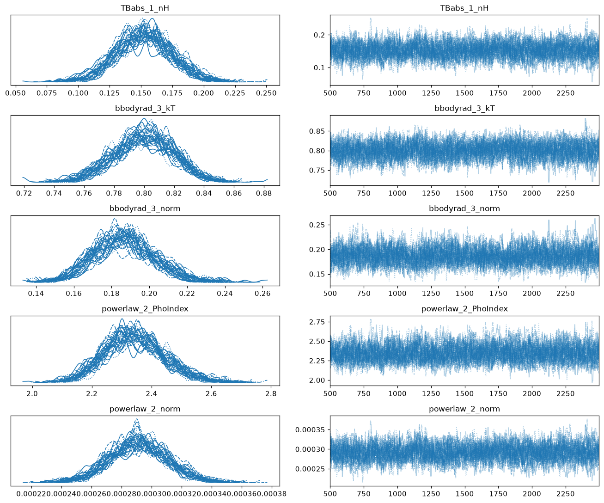
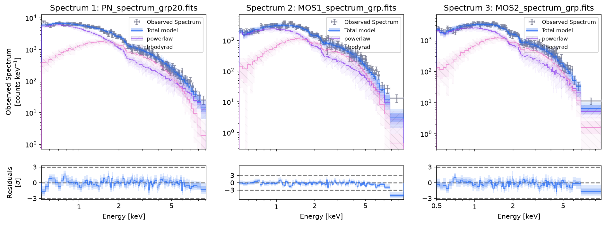
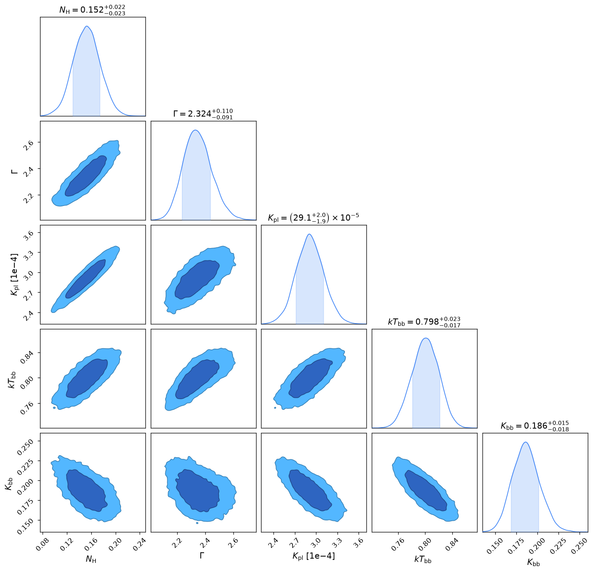

# MCMC from the best fit

This page fits the XMM-Newton spectra of the ultraluminous X-ray source NGC 7793 ULX-4 with the [`Emcee`][bsixsa.backend.config.Emcee] ensemble sampler. The walkers start in a small ball around the best fit, which is found first with the [`LevenbergMarquardt`][bsixsa.backend.config.LevenbergMarquardt] optimiser on the same `Solver`. The three EPIC spectra (PN, MOS1 and MOS2) and their backgrounds are fitted together.

The data are available in the [jaxspec-database](https://github.com/renecotyfanboy/jaxspec-database/tree/main/example_data/NGC7793_ULX4) repository. Download the content of the folder and run the snippets from it: the headers of the spectra point to their background and response files.

## Data loading with PyXSPEC

The three spectra are loaded in data group 1, so that they share the model parameters. Each of them has a background file, so XSPEC's `cstat` becomes the W-statistic.

``` python title="Load the three EPIC spectra"
import xspec

xspec.AllData.clear()
xspec.AllModels.clear()

xspec.Fit.statMethod = "cstat"  # W-statistic, since the spectra have a background
xspec.Fit.bayes = "off"         # bsixsa applies the priors itself
xspec.Xset.abund = "wilm"
xspec.Xset.xsect = "vern"

xspec.AllData("1:1 PN_spectrum_grp20.fits 1:2 MOS1_spectrum_grp.fits 1:3 MOS2_spectrum_grp.fits")
xspec.AllData.ignore("bad")
xspec.AllData.ignore("0.0-0.5 10.0-**")
```

The continuum is an absorbed power law plus a blackbody.

``` python title="Setup the XSPEC model"
xspec_model = xspec.Model("tbabs*(powerlaw + bbodyrad)")
```

## Prior distributions

Every free parameter gets a prior. The normalisations and the column density span several decades, so their priors are log-uniform.

``` python title="Define prior distributions"
from bsixsa.priors import uniform, loguniform

prior = [
    ("TBabs_1", "nH", loguniform(1e-3, 1.)),
    ("powerlaw_2", "PhoIndex", uniform(0., 4.)),
    ("powerlaw_2", "norm", loguniform(1e-7, 1e-2)),
    ("bbodyrad_3", "kT", uniform(0.05, 3.)),
    ("bbodyrad_3", "norm", loguniform(1e-6, 1e2)),
]
```

## Best fit

Create the solver with the `LevenbergMarquardt` optimiser, which starts from the prior median and returns the maximum a posteriori parameters in `best_fit`. It fits the counts of the first spectrum only (PN here), without its background (see [Current limitations](../index.md#current-limitations)): its best fit is only an approximate starting point, and the MCMC below then samples the posterior of the three spectra with their backgrounds.

``` python title="Find the best fit"
from bsixsa import Solver, LevenbergMarquardt

solver = Solver(
    prior,
    outputfiles_basename="result/",
    overwrite=True,
    backend=LevenbergMarquardt(),
)

best_fit_result = solver.run()
print(best_fit_result.best_fit)
```

```
TBabs_1_nH             0.078617
powerlaw_2_PhoIndex    1.922223
powerlaw_2_norm        0.000252
bbodyrad_3_kT          0.739088
bbodyrad_3_norm        0.204464
dtype: float64
```

## MCMC around the best fit

`Emcee` places its walkers around `x0_physical`, one value per free parameter in the order of `solver.parameter_names`, which is the order of `best_fit`. Each walker starts at `x0_physical * (1 + init_spread * N(0, 1))`: here a 1% scatter around the best fit. Replacing `solver.backend_config` keeps the data, the model and the priors, and the next `run` uses the new backend.

``` python title="Run emcee from the best fit"
from bsixsa import Emcee

solver.backend_config = Emcee(
    x0_physical=best_fit_result.best_fit.to_numpy(),
    init_spread=1e-2,
    num_walkers=32,
    num_warmup=500,
    num_samples=2_000,
)

fit_result = solver.run()
```

Any starting point works the same way, for instance the parameter values of a fit done in XSPEC beforehand. The 32 walkers make 2,500 steps each, about 80,000 folds in one minute on a laptop. The posterior holds the 64,000 draws recorded after the burn-in.

## Checking the chain

`az.from_emcee` turns the emcee sampler, available after the run as `solver.backend.sampler`, into an ArviZ `InferenceData` with one chain per walker. The burn-in is dropped with `sel`, as in the posterior samples. (`solver.build_inference_data()` puts random draws of the chain into a single ArviZ chain, without the walker structure that these diagnostics need.)

``` python title="Convert the chain to ArviZ"
import arviz as az

sampler = solver.backend.sampler
idata = az.from_emcee(sampler, var_names=solver.parameter_names)
idata = idata.sel(draw=slice(500, None))  # drop the burn-in
```

The summary reports the split $\hat{R}$ across walkers and the effective sample sizes. emcee walkers are not independent chains, so $\hat{R}$ is only indicative, but values above about 1.05 would mean that the walkers have not mixed. Here $\hat{R} = 1.01$ for every parameter, and the bulk ESS of about 2,000 matches the 64,000 draws divided by the autocorrelation time of the walkers.

``` python title="Convergence diagnostics"
print(az.summary(idata, kind="diagnostics"))
print(sampler.get_autocorr_time(discard=500, quiet=True))  # [26.3 25.2 27.0 25.9 27.7]
print(sampler.acceptance_fraction.mean())                 # 0.40
```

```
                     mcse_mean  mcse_sd  ess_bulk  ess_tail  r_hat
TBabs_1_nH               0.000    0.000    2083.0    4049.0   1.01
bbodyrad_3_kT            0.000    0.000    2118.0    4259.0   1.01
bbodyrad_3_norm          0.000    0.000    1952.0    3334.0   1.01
powerlaw_2_PhoIndex      0.002    0.001    2229.0    4735.0   1.01
powerlaw_2_norm          0.000    0.000    2037.0    3899.0   1.01
```

The trace plot shows one density and one trace per walker. The densities of the 32 walkers overlap and the traces show no trend after the burn-in, although the walkers started from the PN-only best fit, away from the posterior of the three spectra.

``` python title="Trace plot"
az.plot_trace(idata, compact=True, combined=False);
```


/// caption
Marginal density (left) and trace (right) of each walker after the burn-in.
///

## Results

The posterior predictive check compares the three spectra with spectra simulated from the chain.

``` python title="Posterior predictive check"
solver.plot_predictive_coverage("posterior", min_counts=20, residual_kind="sigma", figsize=(15, 5));
```


/// caption
Posterior predictive coverage of the PN, MOS1 and MOS2 spectra.
///

The corner plot shows the posterior from the chain.

``` python title="Corner plot of the posterior"
from chainconsumer import Chain, ChainConsumer, PlotConfig

c = ChainConsumer()
c.add_chain(Chain(samples=fit_result.posterior_samples, name="Emcee"))
# LaTeX labels: the column names contain underscores, which break the summary titles.
c.set_plot_config(PlotConfig(labels={
    "TBabs_1_nH": r"$N_\mathrm{H}$",
    "powerlaw_2_PhoIndex": r"$\Gamma$",
    "powerlaw_2_norm": r"$K_\mathrm{pl}$",
    "bbodyrad_3_kT": r"$kT_\mathrm{bb}$",
    "bbodyrad_3_norm": r"$K_\mathrm{bb}$",
}))
c.plotter.plot();
```

{ width="700"}
/// caption
Posterior from emcee.
///

The chain can also be exported to XSPEC for its `error` and `flux` commands, as in the [simple fit](demo.md#errors-and-fluxes-with-xspec).
